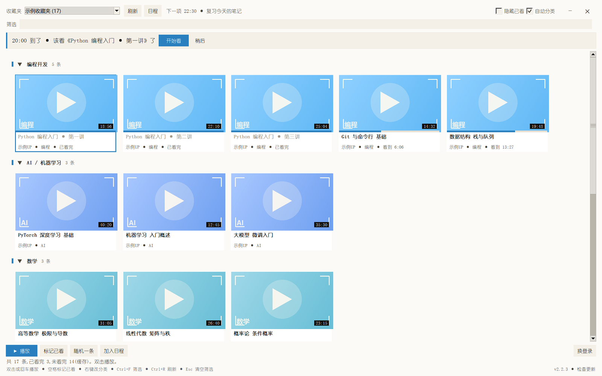
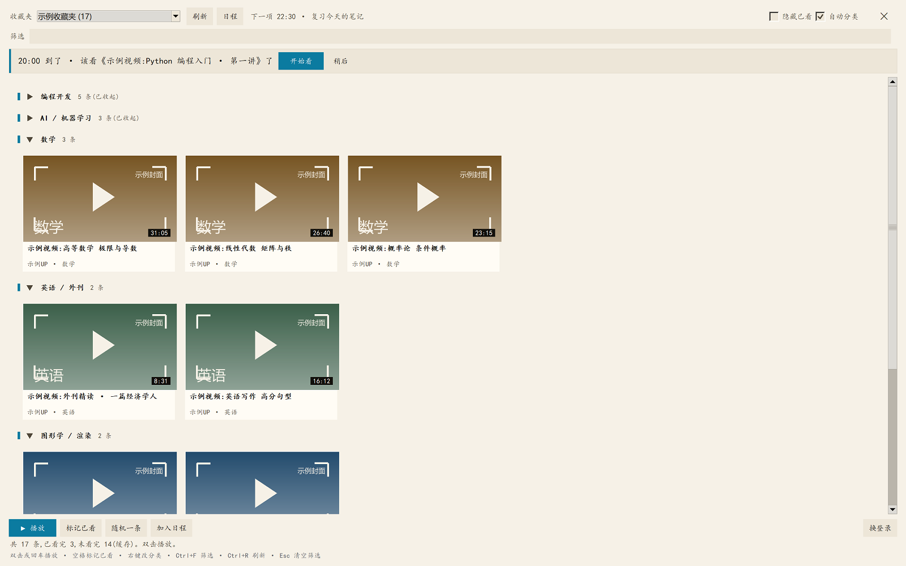
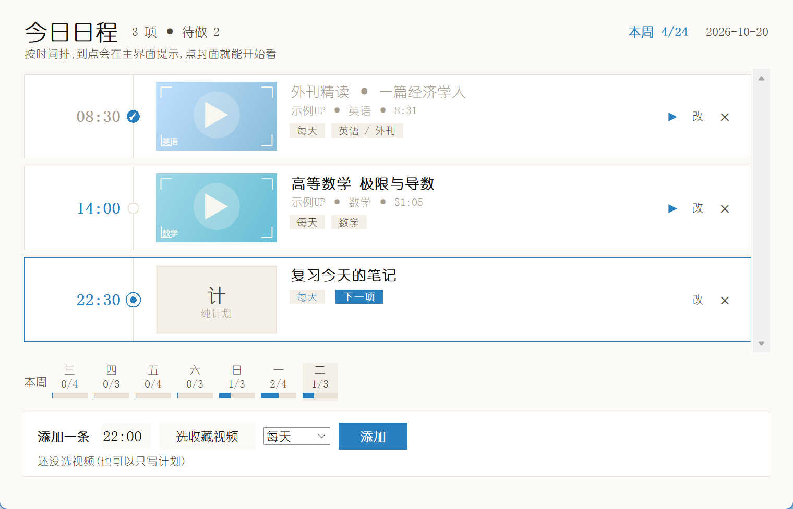
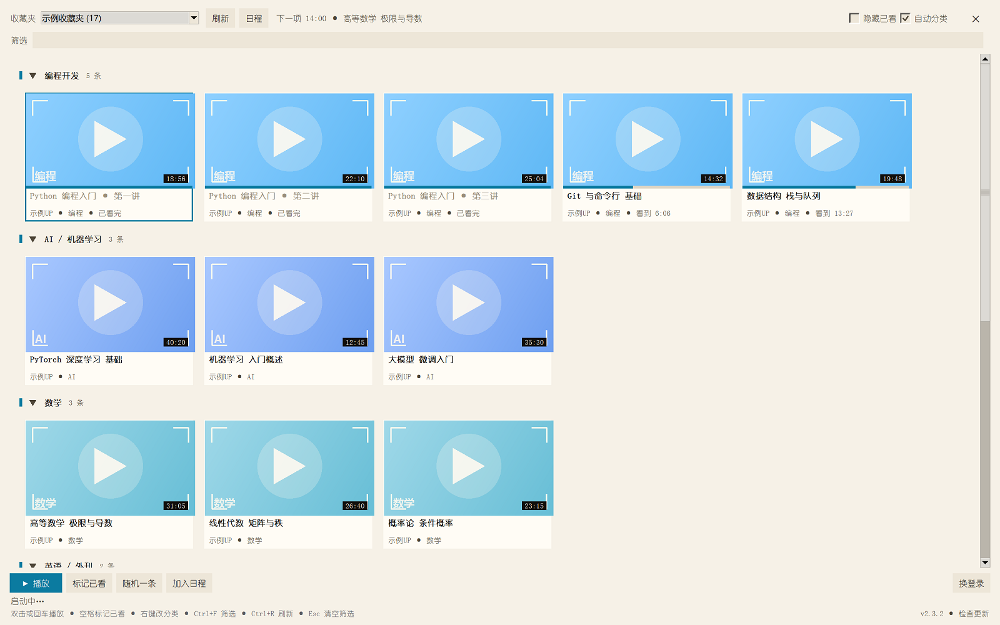
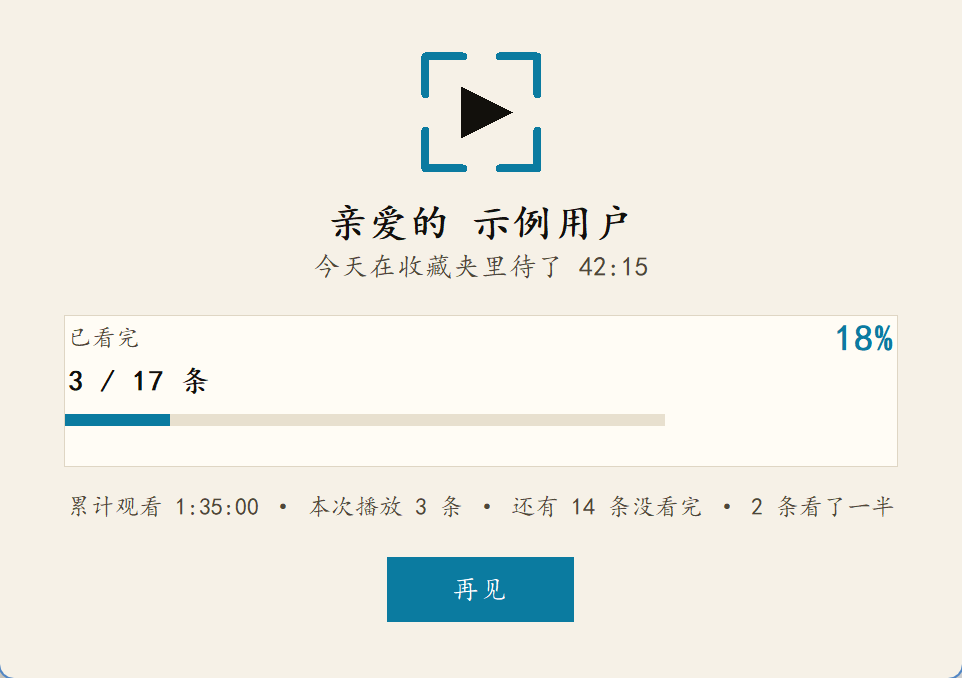

# BiliFocus

**只看收藏夹,不被推荐流带走。** 一个 Windows 桌面小工具:打开就是你的 B 站收藏夹,
点开即全屏播放,看完自动记进度,下次接着看。



| 自动分类 + 收起 | 日程 |
|---|---|
|  |  |

到点提醒(只在应用内,不弹系统窗口):



| 手机扫码登录 | 退出小结 |
|---|---|
|  |  |

> 截图使用**示例数据**(示例收藏夹、示例视频标题),不含任何真实账号信息;
> 需要重新生成可以运行 `python dev/make_screenshots.py`。

## 功能一览

- **只看收藏夹**:没有首页推荐、没有弹幕列表,只有你收藏的东西
- **卡片网格 + 封面**:封面异步加载、进度条标记看到哪儿、响应式列数
- **自动全屏播放**:点开就全屏、自动播放;记录真实观看进度,下次 `?t=秒` 续播
- **手机扫码登录**:应用内显示二维码,手机 B 站 App 扫一扫即可(也支持独立浏览器登录)
- **自动分类**:按关键词把收藏分成 编程 / 数学 / AI / 英语 / 图形学 / 公开课…,可整类收起,
  **右键卡片可以手动改分类**(改一次就记住)
- **日程**:自己写的时间表,勾选完成、跨天自动重置,工具栏提示"下一项"
- **退出小结**:关窗口时给一张结算卡(亲爱的{用户名} + 观看时长 + 已看完比例)
- **凭证加密**:SESSDATA 用 Windows DPAPI 加密后存盘(绑定当前用户,拷走文件也用不了)
- **零第三方依赖**:只用 Python 标准库 + tkinter(内置了一个 MIT 的二维码编码器)

> 需要 Python 3.10+ 和 tkinter(Windows 官方安装包默认带)。登录后所有数据只存本机
> `%APPDATA%\bili-focus`,不上传任何服务器。

---

## 下载安装(普通用户)

1. 到仓库的 **Releases** 页面下载最新的 `BiliFocus-Setup-x.y.z.exe`;
2. 双击 → 点「安装」(默认装到 `%LOCALAPPDATA%\Programs\BiliFocus`,**不需要管理员权限**);
3. 从桌面 / 开始菜单打开,点「手机扫码登录」扫一下。

安装器会创建桌面和开始菜单快捷方式,并在 Windows「设置 → 应用」里登记卸载入口。
卸载时会问一句:要不要同时删除观看记录(默认保留)。

> 数据始终在本机 `%APPDATA%\bili-focus`,和绿色版 exe 完全通用——两者可以互相替换,
> 登录态 / 进度 / 日程都接着用。

## 版本与更新

| 事情 | 怎么做 |
|---|---|
| 改版本号 | 改 `pyproject.toml` 的 `version` 和 `bilifocus/__init__.py` 的 `__version__`(两处保持一致) |
| 发新版 | `git tag v2.0.1` → `git push origin v2.0.1`,CI 自动打 `BiliFocus.exe` + `BiliFocus-Setup-2.0.1.exe` 并挂到 Release |
| 老用户更新 | 下载新安装包**覆盖安装**即可:若旧版本正在运行,安装器会自动关掉它;程序文件替换,`%APPDATA%\bili-focus` 的数据完全保留 |
| 为什么不做静默自动更新 | 覆盖安装已经是"下载→双击→安装";后台静默替换程序会引入安全和排查成本,不值得 |

安装后在 Windows「设置 → 应用」里能看到版本号;想回旧版本,下载那版安装包覆盖安装即可。

## 打包成 exe(不用装 Python)

```powershell
python -m pip install pyinstaller
python dev/build_exe.py
```

产物是 `dist/BiliFocus.exe`(约 12 MB,单文件)。双击就能跑,目标机器不需要装 Python。
图标、字体、二维码库都打进包里;数据仍然只写本机 `%APPDATA%\bili-focus`。

> 分发建议:把 exe 传到 GitHub 的 **Releases** 里,而不是直接塞进仓库
> (二进制文件进 git 会让仓库越来越重,`dist/` 已经在 `.gitignore` 里)。

## 代码结构

分层是单向的:界面层(`ui_*.py`)只调用服务层(`service.py`)的公开方法,底层不依赖界面。

```
bilifocus/
  wbi.py            WBI 签名(纯函数,官方向量验证)
  http.py           传输层(限速 + 重试,可注入替身)
  models.py         数据模型(脏数据兜底)
  client.py         B 站 API 客户端(只读)
  covers.py         封面下载与缓存
  store.py          本机持久化(state.json + 缓存)
  service.py        服务门面:缓存、进度、统计、日程
  topics.py         自动分类:关键词打分
  schedule.py       日程规则(重复规则、按日完成)
  qrlogin.py        手机扫码登录
  browser_login.py  独立浏览器登录 + CDP 取 Cookie
  player.py         播放器:CDP 采样观看进度
  winproc.py        静默执行外部命令(不弹控制台窗口)
  install.py        安装/卸载(注册表、快捷方式)
  theme.py          配色、字体、DPI 适配
  ui_splash.py      启动动画
  ui_cards.py       卡片网格(单画布绘制 + 虚拟化)
  ui_schedule.py    日程面板
  ui_farewell.py    退出小结
  ui_tk.py          桌面壳:工具栏、全屏、播放、日程入口
  cli.py            命令行入口
  vendor/           内置二维码编码器(Project Nayuki,MIT)
```

界面是可替换的一层:重写 `ui_*.py` 即可换皮,`service.py` 及以下都不用动。

## 快速开始

把仓库克隆到本地,所有命令都在仓库根目录执行:

```powershell
git clone <你的仓库地址> BiliFocus
cd BiliFocus
```

```powershell
cd BiliFocus

# 1. 登录:终端里显示二维码,用 B 站手机客户端扫一下
python -m bilifocus login --qrcode

#    (不想扫码也可以:login --browser 走独立浏览器,或 login 手动粘 SESSDATA)

# 2. 看有哪些收藏夹
python -m bilifocus folders

# 3. 列内容(第一次会记住 fid)
python -m bilifocus list --fid 12345678

# 4. 自检
python -m bilifocus doctor
```

图形界面(当前版本):双击 `启动 BiliFocus.cmd`(实际调用 `bilifocus.cmd`),或
`python -m bilifocus.ui_tk`。登录框的默认按钮是 **「手机扫码登录」**。

命令行版用 `bilifocus-cli.cmd`,例如 `bilifocus-cli.cmd list --fid 12345678`。

---

## 命令行

| 命令 | 作用 |
|---|---|
| `status [--json] [--offline]` | 数据目录、登录态、已看数量 |
| `login [--sessdata X] [--stdin]` | 保存并**验证** SESSDATA(失败自动回滚) |
| `login --qrcode` | 终端显示二维码,手机扫码登录(推荐) |
| `login --browser` | 开独立浏览器登录,自动取走 SESSDATA |
| `logout [--forget-browser]` | 删除本机凭证;加参数连浏览器配置一起删 |
| `folders [--mid M] [--json]` | 列出账号下的收藏夹 |
| `list [--fid F] [--refresh] [--search K] [--limit N] [--all] [--json]` | 列收藏内容 |
| `watch KEY` / `unwatch KEY` | 标记 / 取消已看(`KEY` 是 BV 号或 `av<aid>`) |
| `watched [--fid F]` | 列出看过的 |
| `random [--open]` | 随机挑一条没看过的 |
| `export --out PATH` | 导出 CSV 或 JSON(后缀决定格式) |
| `doctor [--offline]` | 自检:签名、目录、登录态、接口连通性 |

退出码:`0` 成功,`1` 业务失败(带可读原因),`2` 用法错误。

`--json` 的输出是稳定的结构化数据,便于以后接别的界面或脚本。

---

## 手机扫码登录

登录框的默认按钮是 **「手机扫码登录」**;命令行是 `login --qrcode`。流程:

```
生成二维码(GET qrcode/generate → url + qrcode_key)
  → 在窗口/终端里画出来
  → 手机 B 站 App 扫一扫
  → 每 1.8 秒轮询 qrcode/poll
      86101 未扫码 → 继续等
      86090 已扫码 → 提示在手机上点「确认登录」
      86038 已失效 → 自动刷新二维码
      0     成功   → 从返回的 url 里取出 SESSDATA
  → 保存并校验登录态
```

**安全说明**:这两个接口都是匿名的,只和 `passport.bilibili.com` 通信;二维码内容由
B 站下发,**不经过任何第三方服务**(没有把二维码交给外部图片接口去渲染)。

**二维码有效期约 3 分钟**。界面里过期会自动刷新;命令行里过期会提示重新运行。

**SESSDATA 从哪来**:B 站成功时会同时/或只通过 `Set-Cookie` 下发 Cookie,
所以代码依次尝试 `data.cookie_info.cookies` → `data.url` 查询参数 → `Set-Cookie`
响应头 → 跟随跨域地址再读一次。如果仍然提示「没拿到 SESSDATA」,
设环境变量 `BILI_FOCUS_QR_DEBUG=1` 再运行 `login --qrcode`,
它会把响应结构打到终端(只打印字段名和值的长度,不打印任何凭证),把输出发我即可。

二维码是本地编码的,不依赖 Pillow 之类的大库——内置了 Project Nayuki 的
[QR Code generator](https://www.nayuki.io/page/qr-code-generator-library)(MIT 许可,
原文件逐字保留在 `bilifocus/vendor/qrcodegen.py`)。

---

## 浏览器自动登录

`login --browser`(界面里是登录框上的 **「用浏览器登录(自动获取)」** 按钮)做四件事:

1. 用 **独立的 `user-data-dir`** 启动 Edge/Chrome,打开 bilibili.com;
2. 你在那个窗口里正常登录(登录态只属于这个软件);
3. 软件通过 CDP(DevTools 协议)从**自己的会话**里读 `SESSDATA`;
4. 关掉浏览器,保存并验证登录态。

### 为什么不读你日常浏览器的 Cookie

这是刻意的设计,不是偷懒:

- **技术上不可靠**。Chrome/Edge 较新版本对 Cookie 启用 App-Bound 加密,破解要用
  系统级手段冒充浏览器进程,版本一变就失效;
- **性质上不该做**。读取别的程序的凭据库,在安全审计里和窃取凭据无法区分——哪怕
  目标是自己的账号,这个能力也不该被塞进一个看收藏夹的小工具里。

独立配置的浏览器窗口既解决了"懒得手动复制",又不动你日常浏览器的任何数据。

### 数据落在哪

| 路径 | 内容 |
|---|---|
| `%APPDATA%\bili-focus\browser-profile\` | 那个独立浏览器的配置(含登录态) |
| `%APPDATA%\bili-focus\state.json` | 软件自己存的 SESSDATA |

两个都在 APPDATA,**不在项目目录里**,所以打包/分享代码不会带出登录态。

要彻底清掉:`python -m bilifocus logout --forget-browser`。

### 限制

- 需要本机装有 **Edge 或 Chrome**(没装会提示改用手动粘贴);
- 第一次要**登录一次**;之后配置保留,再跑通常几秒内就能取到;
- 登录期间**不要关那个窗口**,关了会当作取消;
- 默认最多等 **240 秒**,可在 `FavoritesService.login_via_browser(timeout=...)` 调整。

---

## 播放器:自动全屏 + 记住看到哪儿

点一条视频(或双击卡片)时,不再只是丢给默认浏览器,而是:

1. 用 **独立的播放器 profile** 打开 Edge/Chrome,自动**全屏**;
2. 把已保存的 SESSDATA 注进去,所以打开就是登录态;
3. 每 1.8 秒采样一次 `<video>.currentTime`,累计**真实观看时长**;
4. 你关掉窗口后,记录进度:
   - 看到 **≥90% 时长** → 标记为**已看完**,进度保留(退出小结要按它统计),下次从头看;
   - 否则保存进度,卡片封面底部出现一条**进度条**,上传者那行显示「看到 12:34」;看完的卡片显示「已看完」+ 满格进度条;
5. 下次再点同一条,URL 自动带上 `?t=<上次位置>`,**从上次的地方接着看**。

拖动进度条那段**不算观看时长**(时间轴大跳变会被过滤掉),暂停期间也不计。

### 为什么必须接管浏览器

`webbrowser.open` 做不到这些:

- 普通链接**无法让页面全屏**(浏览器要求"用户手势",链接打开的页面没有);
- 也**读不到播放位置**,自然没法记进度和续播。

所以用 Chromium 的调试协议(CDP):启动浏览器时开调试端口,连上去派发
**受信任的鼠标点击**触发全屏,并轮询 `video.currentTime`。整套东西只依赖标准库,
没有 selenium / playwright。

### 失败时的行为

| 情况 | 表现 |
|---|---|
| 没装 Edge/Chrome | 退回默认浏览器打开,状态栏提示"无法跟踪进度" |
| 播放器窗口关得太快 | 没采到样本 → 不记录、不改状态 |
| 中途 CDP 断连 | 自动重连一次;连不回来就带着已有进度收场(不报错) |

关窗后会**兜底清理**浏览器进程,不会留下孤儿窗口。

---

## 全屏与退出

启动后直接进入**无边框全屏**:没有标题栏、没有窗口边框,卡片直接铺满屏幕。

| 操作 | 效果 |
|---|---|
| `ESC` | **退出全屏**(回到普通窗口,尺寸/位置沿用上次) |
| 右上角 `×` | **关闭程序**:保持全屏,直接弹退出小结;点「再见」后进程结束 |

那个 `×` 是**融进背景**的:底色和页面一致,文字用次要文字色,只有轻微色调差别;
鼠标移上去才浮现一个浅色底。它等同于窗口右上角的 ✕——**退出应用**,不是退出全屏;
而且退出时**不会先切回窗口模式**(不会闪一下边框),退出全屏只保留 `ESC` 一个入口。

**切换很稳**:Tk 的 `-fullscreen` 在某些窗口状态下可能残留边框,所以进入全屏时会
先复位最大化状态,再**实际检查窗口样式位**;如果边框还在,自动改用
`overrideredirect` 铺满屏幕。反复进出已验证(界面测试里连做 3 轮)。

---

## 自动分类(可纠正)

自动分类靠标题/UP 主/简介里的关键词打分,**可能会错**。错的时候:

1. 在卡片上**右键**;
2. 选一个正确分类(带 ✓ 的是当前分类);
3. 想反悔就选「恢复自动分类」。

纠正会记在 `state.json` 的 `topic_overrides` 里,下次打开还生效;
被纠正过的视频在分组视图里直接出现在你指定的类里。

## 日程

日程不是文字待办,而是**「几点看哪条收藏」的计划**。工具栏「日程」打开:

```
今日日程      4 项 · 待做 3                    本周 4/24    2026-10-19
──────────────────────────────────────────────────────────────────
✓ 08:30  每天           示例视频:外刊精读 · 一篇经济学人     改  ×  ▶ 开始看
○ 14:00  每天           示例视频:高等数学 极限与导数        改  ×  ▶ 开始看
○ 20:00  每周一、三、五  示例视频:Python 编程入门 · 第一讲   改  ×  ▶ 开始看
○ 22:30  每天           复习今天的笔记                       改  ×
──────────────────────────────────────────────────────────────────
本周  二 0/3 | 三 0/4 | 四 0/3 | 五 0/4 | 六 1/3 | 日 2/3 | 一 1/4
添加 [01:00] [选收藏视频] [每天 ▾] [添加]
```

面板按**时间轴 + 封面卡片**来排:左边是时间和状态点,右边是视频封面、标题、UP 主/时长和标签;
「下一项」用强调色描边,已完成的整体变淡。点封面就能开始看。

**一条日程 = 时间 + 一条收藏视频 + 重复规则**

| 能力 | 说明 |
|---|---|
| 绑定视频 | 「选收藏视频」从当前收藏夹里挑一条,面板里直接点「▶ 开始看」就播放(续播/记进度照旧) |
| 重复规则 | 每天 / 仅今天 / 每周几(勾一、三、五这样的组合) |
| 到位提醒 | 到点后在主界面顶部出一条浅色提示:「20:00 到了 · 该看《…》了」,带「开始看」「稍后」 |
| 看完自动勾 | 从日程播放并看完(进度 ≥ 90%)时,这条日程自动打勾 |
| 本周记录 | 面板底部 7 格显示每天完成/计划数,顶栏显示「本周 4/24」 |
| 编辑 | 行内「改」或双击,可改时间/重复规则,不用删了重建 |
| 宽松输入 | 时间可写 `20:00`、`2030`、`8点30`,默认填下一个整点 |

设计取舍:

- **提醒只在应用内**:画一条背景色系里的横条,不弹系统窗口、不抢焦点,不打断你;
- **完成状态按日期记**,「每天」的日程今天勾了明天自动回到未完成;
- **「仅今天」过期自动归档**,不会堆在列表里;
- 没有绑定视频时也允许只写一句计划(纯文字),不过播放按钮不会出现。

数据存在 `state.json` 的 `schedule` 字段,纯本地;从 v2 旧格式升上来会自动迁移
(旧的 `done_day` 变成按日期记录,默认「每天」)。

---

## 自动分类

工具栏右侧有 **「自动分类」** 开关(默认开启),打开后收藏夹会按主题分组,
同类视频排在一起,每组前面有一条标题栏:

```
▌ 编程开发  15 条
[Python 程序打包] [算法与数据结构] [C++ 游戏开发] ...
▌ AI / 机器学习  12 条
[一天学会 PyTorch] [大模型训练] ...
▌ 数学  9 条
[高等数学 750 题] [矩阵的秩] ...
```

### 怎么分类的

**纯本地关键词打分**,不联网、不依赖模型:

- 标题命中权重 3、UP 主 2、简介 1;
- 取总分最高的类别,总分不到 2 分归「其他」;
- 类别顺序:条数多的在前,「其他」永远最后。

当前的类别(词表在 `bilifocus/topics.py`,想改直接改):

`编程开发` · `AI / 机器学习` · `数学` · `英语 / 外刊` · `图形学 / 渲染` ·
`公开课 / 大学课程` · `科普 / 杂谈` · `其他`

这是**启发式**分类:标题里没关键词的视频会落到「其他」,不会硬塞进某个类。
想让它更准,往对应类别的词表里加词就行,改完重启立即生效。

开关状态记在 `state.json` 的 `ui.auto_group` 里;关掉后回到原来的平铺网格,
筛选、隐藏已看、键盘操作、双击播放都不受影响。

### 收起某一类

每个分类标题前面有一个箭头:

```
▾ AI / 机器学习  11 条        ← 展开
▸ 编程开发  17 条(已收起)     ← 收起后只留标题行
```

点箭头即可收起/展开该组。收起状态记在 `ui.collapsed_groups` 里,
下次打开保持;收起时**不会丢选中项**,滚动位置也会尽量保持。

---

## 滚动性能

早期版本滚动很卡,实测两项数字:

| 指标 | 优化前 | 优化后 |
|---|---|---|
| 滚动一帧的重绘 | **54 ms** | **22 ms** |
| 一次滚轮位移 | 480 px(视口 30%) | 192 px(带 90ms 缓动) |
| 界面里的 Tk 控件 | 280 个(每条视频 5 个) | **0 个**(全部画在主画布上) |

原因和改法:

1. **重绘开销跟"卡片总数"成正比,而不是可见数量** —— 每张卡片都是一套真实控件。
   改成**一张卡 = 主画布上的一组图形**,控件数归零。
2. **虚拟化**:只为"视口 ±1 行"画卡片,滚出范围的直接删掉;
   滚进来的才画(约 1ms/张)。
3. **滚轮步进太粗**:原来一格跳 3 个 unit(视口的 30%)。
   改成像素级(`WHEEL_STEP=96` 设计像素)+ 16ms 帧的缓动动画。
4. **重复摆放**:每帧都对所有卡片重新 `place()` 会触发布局重算,改成坐标不变就不摆。

如果要继续调:滚动手感在 `ui_cards.py` 顶部
(`WHEEL_STEP` 步长、`SCROLL_FRAME_MS` 帧间隔、`BUFFER_ROWS` 预绘行数)。

---

## 退出小结

关掉窗口时不是"啪"地消失,而是一张小结算卡:

```
      [取景框 logo]
   亲爱的 示例用户
   今天在收藏夹里待了 12:34

   已看完                  47%
   26 / 55 条
   [=========-----------------]

   累计观看 1:02:05 · 本次播放 3 条 · 还有 29 条没看 · 2 条看了一半

              [ 再见 ]
```

- **开头固定是「亲爱的 + 用户名」**,用户名从登录信息里取,离线时用上次记住的;
- **观看时间**:本次会话时长 + 历史累计(看完的视频也算进去,不会因为清进度而丢失);
- **已看完** = 播放进度 ≥90% 的条数 / 收藏夹总数(只认播放进度,**不看**手动按空格标的「已看」),进度条让它一眼可读;
- 还会提一句「还有 N 条没看完 · M 条看了一半」,不催不劝,只是给个现状;
- 点「再见」(或回车/ESC)才真正退出;窗口右上角的 ✕ 效果相同。

数据落在 `state.json` 的 `stats` 字段:

```json
"stats": {"total_watch_seconds": 3725.0, "plays": 12, "finished": 26}
```

---

## 自动增量

收藏夹不会天天大变,但每次全量翻一遍很浪费(55 条 = 3 个请求)。所以默认改成
**增量核对**:

```
过 3 分钟(默认)
  → 只拉第 1 页(1 个请求)
  → 逐条比对缓存:遇到第一条"已经认识"的就停
  → 有新增:插到最前面,写回缓存,界面提示「新增 N 条」
  → 没变化:只更新时间戳,缓存文件一个字节都不改写
```

**什么时候退回全量:**

| 情况 | 处理 |
|---|---|
| 没缓存(第一次) | 全量 |
| 总数变少(有取消收藏) | 全量 |
| 新增后总数对不上(可能同时增删) | 全量 |
| 新增超过 5 页(100 条) | 全量 |

界面里默认每 **180 秒**核对一次,只有在**真的有新内容**时才重画列表,并保持你
当前选中项不动。没变化就完全安静。

**关掉它**:把 `%APPDATA%\bili-focus\state.json` 里的 `auto_sync_seconds` 改成 `0`。

**实测(真实接口,55 条收藏):**

```
全量同步    4 个请求(nav 1 + 3 页)
增量核对    1 个请求
```

也就是稳定状态下,自动更新只花全量的 1/3。

---

## 给前端用的 API

```python
from bilifocus import FavoritesService

service = FavoritesService()          # 默认读 %APPDATA%\bili-focus

# 登录(失败抛 AuthRequiredError,不会留下无效凭证)
state = service.login("SESSDATA=...")
print(state.uname, state.mid)

# 或者:开独立浏览器让你登录,自动取走 SESSDATA
state = service.login_via_browser(progress=lambda msg: print(msg))
service.forget_browser_login()        # 连浏览器配置一起清掉

# 收藏夹
folders = service.folders(87654321)  # tuple[Folder]

# 内容:默认每 3 分钟核对一次,只拉第 1 页
view = service.videos(12345678)
view.videos          # tuple[Video]
view.from_cache      # 这次是直接读缓存,还是真有变化
view.new_count       # 本次新增几条(0 = 没变化)
view.checked_at      # 上次联网核对的时间

# 强制全量重拉(会翻完所有页),并可拿进度回调
view = service.refresh(12345678, progress=lambda page, got, total: ...)

# 调整"多久核对一次"(0 = 每次都核对,便于调试)
service = FavoritesService(sync_interval=60)

# 单页(给"加载更多"用,不缓存)
page = service.page(12345678, 2)

# 已看标记(存盘,跨进程有效)
service.mark_watched(video)        # 或 service.mark_watched("BV1xx411c7mD")
service.toggle_watched(video)
service.is_watched(video)
service.watched_count(view)

# 随机一条没看过的
service.random_unwatched(view)

# 汇总统计(前端不该自己算)
service.stats(view)
# {'count': 23, 'watched': 5, 'unwatched': 18, 'invalid': 1,
#  'total_duration_seconds': 12345, 'total_duration_text': '3 小时 25 分钟',
#  'top_uploaders': [{'upper': '某UP', 'count': 7}, ...]}

# 导出
service.export_csv(view, "out/fav.csv")   # utf-8-sig,Excel 直接打开
service.export_json(view, "out/fav.json")
```

`Video` 上直接可用:`title` / `upper` / `duration_text` / `bvid` / `url` /
`is_valid` / `is_openable` / `key`(已看标记用的稳定键)。

**错误处理**:所有可预期失败都继承 `BiliFocusError`。前端按类型分支即可:

```python
from bilifocus import AuthRequiredError, PermissionDeniedError, RiskControlError

try:
    view = service.videos(fid)
except AuthRequiredError:
    ...   # 提示重新粘贴 SESSDATA
except PermissionDeniedError:
    ...   # 私密收藏夹 / 不是这个账号的
except RiskControlError:
    ...   # 降低频率,稍后重试
```

---

## 测试

```powershell
cd BiliFocus

# 单元测试(不联网)
python -m unittest discover -s tests -t .

# 加上真实网络集成测试
$env:BILI_FOCUS_INTEGRATION='1'
python -m unittest discover -s tests -t .
```

当前:**340 项离线测试 + 3 项真实网络集成测试全部通过(共 343)**。

两个界面测试(会真的建一个 Tk 窗口,约 1 秒):

```powershell
python dev/smoke_ui.py      # 渲染、筛选、标记、隐藏、偏好持久化
python dev/test_startup.py  # 用无效凭证跑完整启动链路
```

### 签名测试用的是官方向量,不是自己验自己

`tests/test_wbi.py` 里的锚点来自 [bilibili-API-collect 的 wbi 文档](https://github.com/SocialSisterYi/bilibili-API-collect/blob/master/docs/misc/sign/wbi.md):

| 用例 | 期望 |
|---|---|
| `mixin_key(img+sub)` | `ea1db124af3c7062474693fa704f4ff8` |
| `foo/bar/zab` + `wts=1702204169` | `w_rid=8f6f2b5b3d485fe1886cec6a0be8c5d4` |
| `one one four` 的编码 | `one%20one%20four`(空格不是 `+`) |

集成测试进一步证明**真实服务器接受我们的签名**:对 `x/web-interface/wbi/view`
发签名请求能拿到 `code=0` 和正确数据。签名错会被拒,所以这是一次端到端验证。

### 覆盖到的边界

- 空壳条目(被删除的视频)被丢弃;有 aid 无 BV 号的标为失效但保留
- `attr & 1` 判定失效;缺 UP 名兜底
- `nav` 匿名返回 `code=-101` 但 `wbi_img` 有效 —— 不能当错误
- `code=0` 但 `data.v_voucher` 的"伪成功"必须识别并重试
- `-403` 只在消息含"签名"时重试;权限类 `-403` 不重试
- `ps` 硬上限 20;空页立即停止翻页;`max_pages` 保护
- 增量核对:无变化只 1 个请求、不重写缓存;有新增时插到最前
- 增量退回全量的四种情况(无缓存 / 总数变少 / 总数对不上 / 超过 5 页)
- 同步时间戳用注入时钟测;失败不写缓存
- 状态文件的读改写有可重入锁;并发标记不丢更新
- 同一进程多线程落盘时临时文件名唯一,不留 `.tmp`,不产生半个 JSON
- 状态文件损坏 → 备份成 `state.corrupt-<ts>.json` 后重置
- v1 状态文件(无 `schema`)自动迁移
- 写盘原子化(临时文件 + `os.replace`),不留 `.tmp`

---

## 文件清单

| 文件 | 作用 |
|---|---|
| `bilifocus/*.py` | 底层包(签名、传输、模型、存储、服务、CLI) |
| `bilifocus/browser_login.py` | 独立浏览器登录 + CDP 取 Cookie(自带 WebSocket 客户端) |
| `bilifocus/qrlogin.py` | 手机扫码登录(生成二维码、轮询状态、取 SESSDATA) |
| `bilifocus/vendor/qrcodegen.py` | 内置二维码编码器(MIT,Nayuki,逐字保留) |
| `bilifocus/ui_cards.py` | 封面卡片网格(Canvas + 异步加载封面 + 响应式列数) |
| `bilifocus/ui_splash.py` | 启动页(Canvas 矢量动画,无图片资源) |
| `bilifocus/player.py` | 播放器:自动全屏 + CDP 采样观看进度 + 续播 |
| `bilifocus/topics.py` | 自动分类:本地关键词打分 + 分组排序 |
| `bilifocus/schedule.py` | 日程:时间解析、排序、下一项、跨天重置 |
| `bilifocus/ui_schedule.py` | 日程面板(自己设定时间 + 内容) |
| `bilifocus/ui_farewell.py` | 退出小结卡(亲爱的{用户名} + 观看时长 + 已看完比例) |
| `bilifocus/install.py` | 安装/卸载逻辑(注册表、快捷方式、覆盖安装) |
| `bilifocus/theme.py` | 配色、字体、DPI 适配、卡片尺寸(界面与网格共用) |
| `bilifocus/ui_tk.py` | 可替换的桌面壳 |
| `bilifocus.cmd` | 界面启动器(双击用) |
| `启动 BiliFocus.cmd` | 中文名包装,指向 `bilifocus.cmd` |
| `bilifocus-cli.cmd` | 命令行启动器 |
| \	ests/\ | 331 项离线测试 + 3 项联网集成测试(共 334) |
| `dev/smoke_ui.py` / `dev/test_startup.py` | 界面冒烟与启动链路测试 |
| `dev/check_imports.py` | 轻量未使用 import 检查(无第三方 linter 时用) |
| `dev/probe_network.py` | 手动联调脚本(匿名打真实接口) |
| `dev/build_exe.py` | 打单文件 exe(PyInstaller) |
| `dev/build_installer.py` | 打 Windows 安装包(内嵌 exe + 安装向导) |
| `dev/installer_app.py` | 安装器界面与安装/卸载流程 |
| `dev/lab_card.py` | 卡片样式练习场(改它不影响主程序) |
| `dev/*.cmd` | 跑测试 / 打开练习场的双击入口 |

## 数据放在哪

| 文件 | 内容 |
|---|---|
| `%APPDATA%\bili-focus\state.json` | 凭证、已看标记、界面偏好(小、常改) |
| `%APPDATA%\bili-focus\cache\fav-<fid>.json` | 收藏夹缓存(大、可丢) |
| `%APPDATA%\bili-focus\player.log` | 播放器启动日志(排查「视频一开就退」用,可删) |

用 `BILI_FOCUS_HOME` 环境变量可以整体改到别的目录(测试和便携用法靠它)。

刻意分成两个文件:标记一条已看不该顺带重写整个收藏夹列表。

---

## 登录凭证怎么存

`state.json` 里的 SESSDATA 相当于账号密码,所以**不存明文**:

| 平台 | 做法 |
|---|---|
| Windows | DPAPI(`CryptProtectData`)加密,密钥由 Windows 按**当前用户**管理 |
| 其它平台 | 退化为基础 base64(只防肉眼,不真正加密;开发用) |

实际效果:

- `state.json` 里是 `dpapi:AQAAANCMnd8BFdERjH...` 这样的密文,搜不到 SESSDATA 原文;
- 把 `state.json` 拷到别的机器 / 别的 Windows 用户下 → 解不开,等同未登录;
- 旧版本升级上来的明文凭证,第一次启动时**自动就地加密**;
- 解除登录(换登录 / 退出)会删掉密文。

想确认当前状态:`bilifocus-cli.cmd status` 里会显示 `has_sessdata`,但不会打印凭证本身。

## 持续集成(GitHub Actions)

仓库带了两个 workflow:

| 文件 | 触发 | 做什么 |
|---|---|---|
| `.github/workflows/tests.yml` | push 到 main / PR | 在 Windows 上跑 Python 3.10–3.13 四套:单元测试 + import 检查 + 界面冒烟 + 构建 wheel |
| `.github/workflows/release.yml` | 推 `v*` 标签 | 跑测试 → 用 PyInstaller 打 `BiliFocus.exe` → 挂到 GitHub Release |

发布新版本只要:

```powershell
git tag v2.1.0
git push origin v2.1.0
```

跑完就能在 Releases 页面下载 `BiliFocus.exe`。仓库地址确定后,可以把这个徽章加在
README 顶部(把 `<用户名>` 换成你的):

```markdown

```

## 几个设计决定

**为什么缓存和状态分开写。** 合在一起会让"标记已看"变成一次大文件重写,既慢
又增加损坏风险。

**为什么错误要分这么多类。** 前端要能区分"该让用户重新登录"和"该等一会儿再试"。
把所有失败压成一个字符串,界面就只能给一句笼统的"出错了"。

**为什么签名失败要重试一次。** B 站的 `img_key`/`sub_key` 每日轮换。长跑进程
必然遇到密钥过期,自动刷新比重试让用户看到错误要好。

**为什么编码不用 `urlencode`。** 它把空格编成 `+`,而 B 站要求 `%20`。含空格的
参数会因此签名不匹配——这是文档专门警告过的坑。

**为什么底层不 import 界面。** 界面是整层可替换的:删掉 `ui_*.py`,底层和测试
照样跑。

---

## 已知限制

- **只读**。没有"加入收藏夹""取消收藏",避免误操作和写接口的额外风控。
- **不能下载视频**。只负责产出清单和链接,播放交给浏览器。
- **`--mid` 有内置默认值**(命令行里会标出来)。换账号时要显式传自己的 mid。
- **增量只认"新增在前"**。收藏夹按收藏时间倒序,所以新内容一定在第一页。如果有人
  在别处改写收藏顺序(比如按播放量排序),增量会退回全量。
- **已看标记按 BV 号存**。视频被删除后标记会残留,`prune_watched()` 可清理,但当前
  没有自动调用。

---

## 从 v1 迁移

v1 是单文件 `bili_focus.py`。现在它只剩一个转发壳:

```python
from bilifocus.ui_tk import main
```

`state.json` 结构兼容(v1 的 `{cookies, watched, ui}` 会被自动补上 `schema: 2`),
所以不用重新登录。

---

## 许可证

[MIT](LICENSE)。内置的二维码编码器来自
[Project Nayuki 的 QR Code generator](https://www.nayuki.io/page/qr-code-generator-library)(MIT),
许可证声明保留在该文件头部。

## 免责声明

本项目仅用于**个人管理自己的收藏夹**,只读取公开的收藏夹与视频信息。
请遵守 B 站的服务条款,不要用于批量抓取或商业用途。
